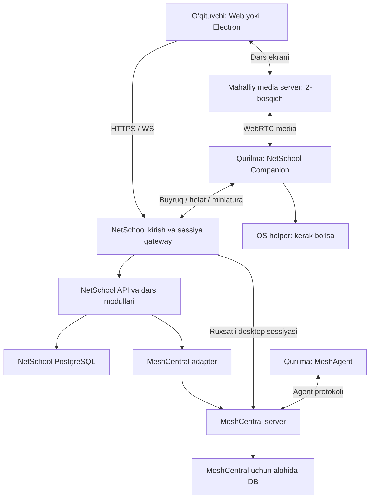
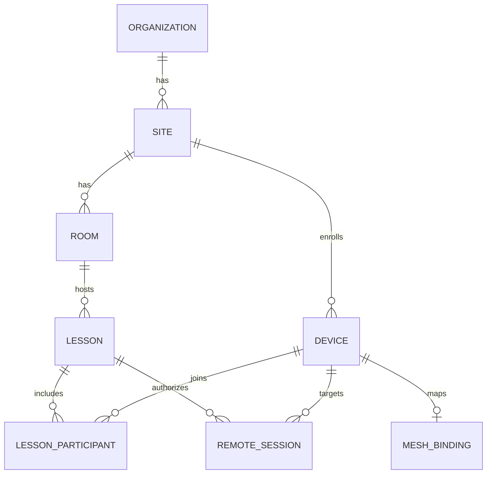

# NetSchool — MeshCentral asosidagi arxitektura

Sana: 2026-10-27 · Holat: amalga oshirish uchun tavsiya etilgan v1 arxitektura.

**Asosiy qaror:** MeshCentral masofaviy qurilma boshqaruvi dvigateli bo‘ladi. NetSchool darslar, sinflar, ruxsatlar, o‘quvchi interfeysi va ta’lim jarayonlarini boshqaradigan mustaqil mahsulot qatlami bo‘ladi. Birinchi versiyada bitta maktab serverida modullarga ajratilgan backend ishlaydi; MeshCentral bilan bog‘liqlik bitta adapterda saqlanadi.

Bu hujjat ishlayotgan yangi dastur yoki barcha OS sinovdan o‘tganligi haqidagi hisobot emas. U kod yozish chegaralari, interfeyslar, ma’lumotlar modeli va qabul mezonlarini belgilaydi.

## 1. Tekshirilgan asos va boshlang‘ich taxminlar

Upstream: `Ylianst/MeshCentral`, tekshirilgan commit `adce1ec488dc884ce947ea4e4808e6a520609b17`. Tekshirish paytida `package.json` versiyasi `1.3.1`, Node talabi `>=20.0.0` edi. Bu commit ishlab chiqarish uchun avtomatik tasdiqlangan release degani emas; pilotdan keyin sinovdan o‘tgan release/commit va image digest pin qilinadi. Foydalanuvchining lokal clone yo‘li bu ish muhitida mavjud emas; uning o‘zgarishlari tekshirilmagan. [S1–S3]

Oldingi `NetSchool.zip` ko‘rib chiqildi. Unda ClassView nomidagi Electron/React/TypeScript prototipi, SQLite/Drizzle, teacher/student rollari, miniaturalar, MJPEG orqali Watch/Show va overlay bloklash kodlari bor. `replica/architecture.md`, `features.csv`, `parity.md` hamda kod bir xil darajada yangilanmagan: ayrim hujjatlar Watch yo‘q desa, `src/main/index.ts` va transport kodi bu oqimni o‘z ichiga oladi. Shu sabab eski hujjatlardagi “tayyor” bahosi yangi release uchun dalil bo‘lmaydi.

Prototipdan olinadigan talablar: LAN rejimi, maktab administratori o‘rnatadigan agent, o‘quvchiga ko‘rinadigan ulanish holati, sinf ekranlari, dars boshqaruvi va internet uzilganda ishlash. Endi “barcha OS” talabi qo‘shiladi. Maktab serveri ajratilishi — ushbu hujjatning yangi tavsiyasi; eski teacher-kompyuter ichidagi server sxemasi o‘zgartiriladi.

Boshlang‘ich hajm: bitta sinfda 30 qurilma; 60 qurilmada stress testi. Bir nechta sinf va katta parkni qo‘llash shu o‘lchovlardan keyin kengaytiriladi. Bu foydalanuvchi bildirgan aniq son emas, loyiha uchun sinov bazasi.

## 2. Tizim chegaralari



Chizmadagi har quti alohida mikroservis degani emas. Dastlab gateway, API, dars modullari, adapter va fon vazifalari bitta TypeScript ilovasidagi modullar bo‘lishi mumkin. MeshCentral alohida jarayon; broadcast qo‘shilganda media server alohida jarayon. Biznes qoidalari controller, WebSocket handler yoki MeshCentral plugin ichiga tarqatilmaydi.

**Maktab serveri — darsning asosiy boshqaruv nuqtasi.** O‘qituvchining oynasi yopilsa ham agentlar, dars holati va siyosatning muddati serverda qoladi. Bulut keyinchalik markaziy hisobot va boshqaruv uchun qo‘shiladi. Mahalliy dars vaqtida bulutga bog‘liq autentifikatsiya, litsenziya tekshiruvi yoki tashqi media xizmati majburiy bo‘lmaydi.

## 3. Qaysi qismni kim bajaradi?

| Qism | Egasi | Vazifasi va chegarasi |
|---|---|---|
| Agent ulanishi, remote desktop va input | MeshCentral + MeshAgent | Tasdiqlangan OS/buildlarda qurilma bilan boshqaruv sessiyasi |
| Terminal va tizim fayllari | MeshCentral | Faqat vakolatli texnik/admin; o‘qituvchiga odatiy huquq emas |
| Maktab, xona, guruh, dars | NetSchool Core | Darsning butun biznes modeli |
| O‘qituvchi paneli | NetSchool Web | Sinf setkasi, kuzatish, yordam, dars boshqaruvi |
| O‘quvchi paneli | NetSchool Companion | Holat indikatori, chat, yordam so‘rovi, yumshoq bloklash, Show qabul qilish |
| Miniaturalar | Companion + NetSchool gateway | 1–2 fps adaptiv JPEG/binary oqim; default holatda diskka yozilmaydi |
| O‘qituvchi ekranini sinfga uzatish | Alohida media modul | WebRTC SFU; MeshCentral desktop protokolini SFU deb qabul qilmaymiz |
| Web/app cheklovlari | NetSchool Policy + OS adapter/extension | Qo‘llab-quvvatlangan muhit bo‘yicha tekshirilgan siyosat |
| Topshiriq va ish yig‘ish | NetSchool Assignments | O‘quvchi fayllari, topshirish holati; adminning diskka kirishidan alohida |
| Audit, buyruq holati, hisobot | NetSchool | Kim, qaysi darsda, qaysi qurilmada nima qilgani |
| Agent yetkazish va yangilash | NetSchool Release | Upstream agentlar va o‘z Companion/helper paketlarining mos kombinatsiyasi |

MeshCentral server, agent va web qismlariga ega; boshqaruv interfeysi asosan WebSocket asosida. Server JavaScript’i Node.js’da, MeshAgent JavaScript’i esa Duktape muhitida ishlaydi. Shuning uchun NestJS yoki istalgan npm kutubxonasini agent ichiga bevosita ko‘chirish mumkin emas. [S4]

## 4. Texnologiya tanlovi

| Qatlam | Tanlov | Sabab |
|---|---|---|
| Boshqaruv UI | React + TypeScript + Vite | Mavjud UI bilimlari va komponentlaridan foydalanish; browser-first |
| Desktop qobiq | Electron | Bor prototipdan foydalanish, tray va ekran ulashish; renderer’da Node huquqi yo‘q |
| Backend | NestJS + TypeScript, modular monolith | Auth, dars, policy va transportni aniq modul chegaralariga ajratish |
| Ma’lumotlar | PostgreSQL + Drizzle | Darslar va ruxsatlar uchun tranzaksiyalar va qat’iy bog‘lanishlar |
| MeshCentral DB | Alohida PostgreSQL database va DB user | Upstream PostgreSQL’ni qo‘llaydi; bitta DB serverini ishlatish mumkin, jadvallar va credentiallar aralashmaydi [S7] |
| Queue va outbox | PostgreSQL outbox + worker | Boshlanishida Redis/Kafka majburiy emas; vazifalar restartda yo‘qolmaydi |
| Endpoint cache | Companion’da SQLite | Siyosat muddati, bajarilgan command ID va kerakli mahalliy holat |
| Imtiyozli OS helper | Go, faqat kerak bo‘lgan funksiyalar uchun | Windows service / macOS daemon / Linux systemd; renderer imtiyozli ishlamaydi |
| Broadcast | Self-hosted LiveKit SFU | 2-bosqichda teacher ekranini bir marta upload qilish va sinfga tarqatish [S12] |
| Topshiriq fayllari | Pilotda mahalliy volume, StoragePort orqali | Keyinchalik S3-compatible storage; DB’da faqat metadata |
| Deploy | Docker Compose, Linux school hub | Paketlangan on-prem o‘rnatish; development Windows/macOS/Linux’da |

Node, Electron va boshqa paketlarning aniq versiyalari compatibility PoC yakunida lockfile va release manifestga yoziladi. Eski prototipdagi versiyalar avtomatik meros olinmaydi. Qo‘llab-quvvatlanadigan Node LTS MeshCentralning pin qilingan versiyasi bilan tekshiriladi. Electron tanlovi mobil platformalar uchun native agent beradi degani emas.

## 5. MeshCentral bilan integratsiya

### 5.1. Adapter chegarasi

NetSchool ichidagi boshqa modullar `nodeid`, upstream rights bitlari yoki `control.ashx` formatini bilmaydi. Faqat `packages/meshcentral-adapter` ularni boshqaradi. Integratsiya MeshCentral DB jadvallarini bevosita o‘qimaydi yoki yozmaydi.

Quyidagi interfeys **biz yozadigan shartnoma**, tayyor MeshCentral SDK yoki mavjud REST endpoint emas:

```typescript
interface DeviceManagementPort {
  listDevices(siteId: string): Promise<DeviceSnapshot[]>;
  reconcileEnrollment(binding: DeviceBinding): Promise<EnrollmentResult>;
  openDesktopSession(request: AuthorizedDesktopRequest): Promise<DesktopSessionRef>;
  closeDesktopSession(sessionId: string): Promise<void>;
  requestPowerAction(request: AuthorizedPowerRequest): Promise<CommandReceipt>;
  subscribeDeviceEvents(handler: (event: DeviceEvent) => void): Unsubscribe;
}
```

`AuthorizedDesktopRequest` server tomonidan tayyorlanadi; brauzerdan kelgan “authorized: true” ishonchli dalil bo‘lmaydi. UUID device ID adapter ichida `(site_id, mesh_instance_id, mesh_domain_id, mesh_node_id)` bog‘lanishiga aylantiriladi.

Upstream `meshctrl.js` inventory, device/group grantlar, realtime eventlar, power va file operatsiyalari uchun protokol namunasidir. U `control.ashx` WebSocket endpointidan foydalanadi. [S5] Production adapter persistent WebSocket, har so‘rov uchun unique correlation ID, timeout, reconnect va qayta sinxronlashni amalga oshiradi. Har UI click uchun yangi `meshctrl` process ochilmaydi. CLI diagnostika uchun qoladi.

Adapter TLS sertifikati/hostname’ni tekshiradi. Upstream CLI’dagi `rejectUnauthorized:false` sozlamasi bizning production klientga ko‘chirilmaydi. Schema validation, xabar hajmi limiti va xatolarni NetSchool error kodlariga aylantirish adapterda bo‘ladi.

### 5.2. Remote desktop sessiyasi

1. Teacher `POST /api/v1/lessons/{lessonId}/remote-sessions` orqali `{deviceId, mode: view|control}` yuboradi.
2. Backend actor, maktab, xona, faol dars, endpoint holati, OS capability va ruxsatni tekshiradi.
3. Qurilma uchun `control` lease olinadi. Bir paytda bitta boshqaruvchi; oddiy `view` alohida read-only huquqdir.
4. Broker aniq sessiya uchun MeshCentral identity/grant tayyorlaydi. Tavsiya: sessiyaga alohida qisqa umrli principal va faqat bitta node huquqi; view uchun server-side view-only, terminal/files/AMT/agent console o‘chiq. Mavjud keng admin credential brauzerga uzatilmaydi. [S6]
5. Browser bir martalik NetSchool ticket’ni HttpOnly, Secure, sessiyaga bog‘langan gateway cookie’ga almashtiradi. Ticket target, actor, mode va lease bilan bog‘liq. Ticketning sarflanganligi serverda atomik belgilanadi.
6. MVP’da upstream desktop view iframe orqali integratsiya qilinishi mumkin. Uning HTTP/WS trafiki sessiyani tekshiruvchi gateway orqali o‘tadi. Upstream login token faqat loginni beradi; token muddati, iframe query yoki yashirilgan tugmalar ruxsat chegarasi emas. Haqiqiy himoya MeshCentral grantlari va gateway tekshiruvidadir. [S8]
7. Dars tugashi yoki huquq bekor bo‘lishida gateway faol WS ulanishlarini yopadi, upstream grant/principal bekor qilinadi, control lease tugatiladi va audit yoziladi. Startup reconciliation osilib qolgan grantlarni tozalaydi.

MVP’da remote desktop uchun majburiy MeshCentral relay yo‘li tanlanadi; bevosita P2P/WebRTC yo‘li sessiyani markazdan to‘xtatish sinovi o‘tmaguncha yoqilmaydi. Keyinchalik uning resurs tejamkorligi alohida baholanadi. Broadcast SFU sessiyalari ham alohida revoke qilinadi.

**Majburiy PoC:** pinned MeshCentral’da scoped identity, iframe/cookie/WS routing, node almashtirishga urinish, view-only input rad etilishi va faol sessiyani uzish amalda isbotlanadi. Login token muddati tugashi ochiq desktopni uzadi deb taxmin qilinmaydi. Gateway qamrab ololmaydigan upstream endpoint bo‘lsa, kichik versioned bridge/plugin yoki minimal fork patch talab etiladi. Bu tekshiruvdan o‘tmagan integratsiya release qilinmaydi.

### 5.3. Upstream bilan ishlash tartibi

`Ylianst/MeshCentral` upstream sifatida saqlanadi. O‘zimizning `netschool` monorepo asosiy ishlab chiqish joyi bo‘ladi; MeshCentral clone shu repoga nusxalanib, biznes kodiga aralashtirilmaydi. Deployment lock’da upstream commit, package versiyasi, image digest va agent manifest versiyasi qayd qilinadi.

Zarur MeshCentral o‘zgarishlari alohida `meshcentral-fork`da kichik commitlar bo‘ladi. Plugin tizimi mavjud [S9], ammo u stable mustaqil servis API deb qabul qilinmaydi. Plugin faqat adapterga yetishmayotgan aniq hook uchun ishlatiladi; dars va DB biznes modeli unda saqlanmaydi. Plugin/server huquqlari keng bo‘lishi mumkin, shuning uchun faqat tekshirilgan pin qilingan paket o‘rnatiladi.

Yangilash: upstream review → alohida upgrade branch → adapter contract tests → OS integration tests → bitta sinf canary → bosqichli rollout. Server, MeshAgent va Companion bir-biridan mustaqil ko‘r-ko‘rona auto-update qilinmaydi. Har upstream patch uchun sabab, test va undan qachon voz kechish sharti yoziladi. MeshCentral Apache-2.0 sifatida belgilangan; release paketida upstream attribution/license hamda har dependency notice’lari saqlanadi. [S1–S2]

## 6. Qurilmadagi arxitektura

O‘quvchi/admin bir NetSchool installer ko‘radi, ichida esa vazifalari aniq ajratilgan qismlar bo‘ladi.

| Jarayon | Privilege | Vazifa |
|---|---|---|
| MeshAgent | Upstream o‘rnatish modeli | Remote desktop/input va texnik boshqaruv |
| NetSchool Companion | Oddiy OS user | Student toolbar, chat, help, screen sharing, thumbnails, overlay |
| NetSchool OS Helper | Faqat kerakli admin/root imkoniyatlari | Versiyalangan allowlist buyruqlari, siyosat adapterlari, xizmat lifecycle |

Helper har boshqariladigan kompyuterda **majburiy** (§7.1, ADR 0007): quvvat, dastur o‘rnatish va OS cheklovlari shu orqali bajariladi. U MeshAgentning remote-desktop dvigatelini qayta yozmaydi. GUI capture logged-in user sessiyasida ishlaydi; root/service process barcha desktop ruxsatlarini avtomatik olmaydi.

Companion va helper orasida ACL bilan himoyalangan named pipe yoki Unix socket ishlatiladi. Peer identity va xabar schema’si tekshiriladi; umumiy “shell(command)” endpoint bo‘lmaydi. Electron renderer sandbox, contextIsolation va cheklangan preload IPC bilan ishlaydi. Rendererga DB, private key yoki MeshCentral admin credential berilmaydi.

Enrollment bir martalik, qisqa muddatli maktab tokeni va qurilmaning o‘zida yaratilgan kalit bilan amalga oshiriladi. Companion identity va MeshAgent node bog‘lanishi admin-enrollment jarayonida tasdiqlanadi; hostname/IP tengligiga qarab avtomatik ishonilmaydi. Qurilma o‘zini boshqa maktabga yoki boshqa node’ga bog‘lay olmaydi. O‘quvchi darsga qo‘shilish kodi enrollment secret yoki remote-admin password emas.

## 7. “Barcha OS” — qo‘llab-quvvatlash modeli

Universal model — hamma qurilmada bir xil binar emas, **umumiy API + OS adapterlari + sinovdan o‘tgan imkoniyatlar jadvali**. Panel ishlashi, native agent o‘rnatilishi va qurilmaning butun OS’ini boshqarish uch xil talabdir.

Quyidagi jadval kelajakdagi mahsulot maqsadi; hozir sinovdan o‘tgan platformalar ro‘yxati emas.

| Platforma | Teacher/Admin panel | Student ishtiroki | Native monitoring/control maqsadi | Release sharti |
|---|---|---|---|---|
| Windows desktop | Web + Electron | Companion | MeshAgent bilan view/control; helper bilan kerakli policy | Signed installer; user/service, UAC, reboot va multi-monitor testi |
| macOS Intel / Apple Silicon | Web + Electron | Companion | Ruxsat berilgan capture/control | Screen Recording va Accessibility holatlari, signing/notarization, har arxitektura testi |
| Linux X11 | Web + Electron | Companion | Qo‘llab-quvvatlangan distro/sessionlarda MeshAgent | Paket, desktop session, input va service testi |
| Linux Wayland | Web + Electron | Companion | ScreenCast/RemoteDesktop portalga asoslangan alohida yo‘l; PoC talab | GNOME/KDE backend, ruxsat dialogi, PipeWire/EIS yo‘li tekshiriladi |
| ChromeOS | Web/PWA | Browser participant, keyin managed extension | Browser doirasidagi imkoniyatlar | Desktop Linux agentini oddiy Chromebook agenti deb hisoblamaymiz |
| Android | Responsive Web | Browser/native participant | Upstream Android agent yoki native adapter alohida baholanadi | Capture roziligi, foreground lifecycle, qurilma boshqaruv rejimi sinovi |
| iOS/iPadOS | Responsive Web | Browser/native participant | Ilova/OS ruxsat bergan screen sharing va ta’lim funksiyalari | Umumiy unattended desktop control v1 majburiyati emas; native SDK/MDM PoC |
| Boshqa OS | Mos brauzer bo‘lsa panel/participant | Capability bo‘yicha | Alohida adapter va sertifikatsiya | Sinovsiz “to‘liq qo‘llanadi” belgisi berilmaydi |

macOS’da capture va accessibility ruxsatlari alohida tekshiriladi; imzolangan/notarized buildning o‘zi ruxsat bermaydi. [S10] Wayland RemoteDesktop portali sessiya va foydalanuvchi ruxsati bilan ishlaydi; MeshAgentning X11 yo‘li uning avtomatik o‘rnini bosa olmaydi. [S11] Android MediaProjection uchun session roziligi talab qilinadi. [S13] Apple screen-sharing SDK tanlovi target OS versiyasiga qarab native PoC’da pin qilinadi. [S14]

Endpoint capability javobi faqat boolean emas:

```json
{
  "protocolVersion": 1,
  "os": "linux",
  "architecture": "arm64",
  "desktopSession": "wayland",
  "capabilities": {
    "screen.view": {"state": "requires_permission", "provider": "portal"},
    "screen.control": {"state": "unsupported", "reason": "adapter_not_certified"},
    "classroom.overlay": {"state": "available", "enforcement": "soft"},
    "web.filter": {"state": "requires_setup", "provider": "managed_extension"}
  }
}
```

UI, backend va endpoint uchalasi capability/policy’ni tekshiradi. UI tugmasining o‘chirilishi yakka himoya emas. Capability ruxsat berilganda, revoke qilinganda, OS user almashganda va agent yangilanganda qayta hisoblanadi.

Hard lock, USB/print cheklash, hamma browser trafikini filtrlash yoki UAC/login-screen boshqaruvi umumiy Electron xususiyati emas. Ular OS Helper va (macOS’da) MDM orqali bajariladi; §7.1’dagi markaziy boshqaruv imkoniyatlari majburiy. Soft overlay funksiyasi interfeysda ham soft sifatida ko‘rsatiladi. OS login lock va classroom overlay alohida command; o‘qituvchi OS parolisiz avtomatik login/unlock va’dasi yo‘q.


### 7.1. Markaziy universitet boshqaruvi (majburiy)

NetSchool butun universitet uchun markaziy dastur: barcha kompyuterlar bitta markazlashgan tarmoq sifatida boshqariladi. Quyidagi imkoniyatlar **har doim bo‘lishi shart** va qo‘llab-quvvatlanadigan har OS’da sinovdan o‘tmaguncha release qilinmaydi (ADR 0007):

| Imkoniyat | Qamrov | Bajaruvchi | Windows | macOS | Linux |
|---|---|---|---|---|---|
| O‘chirish, qayta yuklash, uxlatish | qurilma / xona / bino / butun universitet; darhol yoki jadval bilan | MeshAgent (adapter `requestPowerAction`) | ha | ha | ha |
| Yoqish (Wake-on-LAN) | xuddi shu | shu tarmoq segmentidagi yoqiq agent | BIOS/NIC qo‘llasa | qo‘llasa | qo‘llasa |
| Dastur o‘rnatish / yangilash / o‘chirish (admin huquqi) | qurilmadan butun universitetgacha, bosqichma-bosqich | OS Helper (SYSTEM/root) | MSI / winget | pkg (MDM bilan) | deb / rpm |
| Dastur o‘rnatish va o‘chirishni taqiqlash | bazaviy siyosat | OS Helper; talaba standart foydalanuvchi | AppLocker/WDAC + siyosat | MDM profil | polkit + paket menejer huquqi |
| Oboi va desktop sozlamalarini qulflash | bazaviy siyosat | OS Helper | registry siyosati | MDM profil | dconf lock |
| Remote desktop/control, terminal, fayllar | barcha qurilmalar | MeshCentral (gateway orqali) | ha | ruxsatlar bilan | X11 / Wayland PoC |

- **Rollar.** Markaziy IT admin (butun tashkilot bo‘yicha) — barcha site’larda barcha qurilma boshqaruvi huquqlari. Site IT admini — xuddi shu huquqlar o‘z binosida. O‘qituvchi — faqat o‘z darsidagi dars buyruqlari. Talaba — hech qanday.
- **Har kompyuterda majburiy komponentlar:** MeshAgent, Companion, OS Helper; macOS’da MDM ro‘yxatdan o‘tish. Installer ularni birga o‘rnatadi va hech biri talaba tomonidan o‘chirilmaydi.
- **Siyosat doim amalda.** Bazaviy siyosat hub’da versiyalanadi, Helper qo‘llaydi, davriy tekshiradi va farq (drift) topilsa qayta qo‘llaydi va audit qiladi; tarmoq uzilsa oxirgi bazaviy siyosat qurilmada qoladi (§10).
- **Nazorat.** Har amal auditda. Dastur faqat markaziy katalogdagi imzolangan, checksum’li paketdan. Ommaviy xavfli amal qurilma sonini ko‘rsatib tasdiq so‘raydi va bosqichma-bosqich bajariladi. Natija har qurilma bo‘yicha (§9 command modeli); javobi yo‘qolishi mumkin bo‘lgan quvvat buyrug‘i `unknown` va keyingi tekshiruv bilan.
- **Fizik cheklovlar.** Wake-on-LAN BIOS/NIC va tok borligiga bog‘liq. Jismoniy kirish bilan dasturiy cheklovni chetlab o‘tish mumkin: BIOS/UEFI paroli, yuklash tartibini qulflash va disk shifrlash o‘rnatish yo‘riqnomasining majburiy qismi.

## 8. Backend modullari va ma’lumot modeli

| Modul | Asosiy obyektlar | Mas’uliyat |
|---|---|---|
| Identity & Access | users, memberships, role_assignments | SchoolAdmin, Teacher, ITSupport, Student ruxsatlari |
| Organization | organizations, sites, rooms, room_memberships | Maktablar, filial/xona va o‘qituvchi biriktirish |
| Devices | devices, enrollments, mesh_bindings, device_capabilities | Qurilma identity, enrollment, capability va upstream bog‘lanish |
| Lessons | lessons, lesson_participants, lesson_device_assignments | Boshlash/tugatish, guruhlar, presence |
| Remote Sessions | remote_sessions, control_leases | View/control ruxsati, expiry va faol ulanishlar |
| Policies | policy_versions, policy_assignments, policy_receipts | Desired/applied versiyalar va TTL |
| Commands | commands, command_targets, command_receipts, outbox | Fan-out, bajarish tasdig‘i, qayta jo‘natish |
| Communication | messages, help_requests | Dars chat’i, teacher xabari va yordam so‘rovi |
| Assignments | assignments, submissions, file_objects | Ish tarqatish/yig‘ish, kvota va checksum |
| Audit & Reporting | audit_events | Vakolatli harakatlar va natijalar tarixi |

Kalit bog‘lanishlar:



Invariantlar:

- Barcha business recordlarda `organization_id` va kerakli joyda `site_id` bor. Foreign key’lar scope bilan moslashtiriladi; boshqa maktab device ID’sini almashtirib yuborish ishlamasligi kerak. Shared deployment qo‘shilganda PostgreSQL RLS himoyasi ham kiradi.
- Bitta xonada bitta active lesson: DB partial unique constraint. Teacher biriktirish server tomonda tekshiriladi.
- Bitta device’da bir paytda bitta faol dars assignment’i va bitta control lease. Lease olish atomik tranzaksiya va monoton fencing raqami bilan bajariladi; eskirgan controller buyruqlari rad etiladi.
- `mesh_bindings` uchun `(mesh_instance_id, mesh_domain_id, mesh_node_id)` unique; upstream node ID barcha serverlar bo‘yicha global deb olinmaydi.
- `devices.last_seen_at` tarixiy qiymat; “hozir online” faqat heartbeat freshness va tirik kanal bilan aniqlanadi. MeshAgent online, Companion online va media ready alohida holatlar.
- `command_targets` har recipient uchun natijani saqlaydi. “30 tadan 29 bajarildi” umumiy successga aylantirilmaydi.
- Policy immutable version bilan saqlanadi: `desired_version`, `applied_version`, `expires_at`, `scope`, `ack_at`. Student va qurilma bir obyekt emas; umumiy kompyuterga turli o‘quvchilar kirishi mumkin.
- Buyruq va outbox yozuvi bitta tranzaksiyada. MeshCentral bilan yagona distributed transaction yo‘q; pending/compensation va reconciliation ishlatiladi.
- MeshCentralning DB, sertifikat va agent identity materiallarini NetSchool backup rejasiga alohida qo‘shamiz. Uning sxemasini NetSchool migratsiyalari boshqarmaydi.

## 9. NetSchool API va buyruqlar

Bu endpointlar taklif qilinayotgan NetSchool API; ular upstream MeshCentral endpointlari emas.

| Endpoint | Vazifa |
|---|---|
| `POST /api/v1/enrollments` | Admin qurilma o‘rnatish tokenini yaratadi |
| `POST /api/v1/enrollments/claim` | Qurilma token va public key bilan ro‘yxatdan o‘tadi |
| `GET /api/v1/rooms/{roomId}/devices` | Scope bo‘yicha qurilmalar va readiness |
| `POST /api/v1/rooms/{roomId}/lessons` | Dars ochadi |
| `POST /api/v1/lessons/{lessonId}/end` | Darsni tugatadi, sessiya/policy bekor qilishni boshlaydi |
| `POST /api/v1/lessons/{lessonId}/commands` | Lock-overlay, message, allowed launch kabi typed command |
| `GET /api/v1/commands/{commandId}` | Har device uchun bajarilish holati |
| `POST /api/v1/lessons/{lessonId}/remote-sessions` | View/control sessiyasi |
| `DELETE /api/v1/remote-sessions/{sessionId}` | Grant va transportni bekor qiladi |
| `PUT /api/v1/lessons/{lessonId}/policy` | Yangi desired policy versiyasi |
| `POST /api/v1/lessons/{lessonId}/broadcasts` | 2-bosqichda media room ochadi |
| `POST /api/v1/lessons/{lessonId}/help-requests` | O‘quvchi yordam so‘raydi |
| `GET /api/v1/events` | Authenticated WS/SSE holatlari; reconnectda snapshot + cursor |

Business mutation uchun `Idempotency-Key` qo‘llanadi. API’dagi `202 Accepted` qurilmada bajarildi degani emas. `403 scope_denied`, `409 control_busy`, `409 capability_unavailable`, `503 device_offline` kabi barqaror error kodlari beriladi. `unsupported`, `permission_required`, `expired` natijalari ham UI’da alohida ko‘rinadi.

Command envelope’da `commandId`, `targetDeviceId`, `lessonId`, `issuedAt`, `expiresAt`, `policyVersion`/`fencingToken`, `type`, `payload` bo‘ladi. Endpoint identity kanal bilan bog‘lanadi; actor va scope client yuborgan maydondan ishonchsiz olinmaydi. Qabul qilish, bajarish va natijani tasdiqlash alohida voqealar.

Command lifecycle: `pending → sent → acknowledged → succeeded|failed|expired|cancelled`. Retry faqat expiry ichida va action turiga mos. Message, URL launch yoki reboot qayta jo‘natilganda dublikat bajarilishining oldi olinadi. Tizim universal exactly-once kafolatini da’vo qilmaydi: power kabi javobi yo‘qolishi mumkin bo‘lgan operatsiyada `unknown` va keyingi reconciliation zarur.

Teacher API’da arbitrary shell/script bo‘lmaydi. Markaziy va site IT adminining remote terminali, quvvat, dastur o‘rnatish va siyosat buyruqlari alohida rol va audit bilan boshqariladi (§7.1). Browserga tegishli chat matni yoki URL shell argumentiga aylantirilmaydi.

## 10. Policy, uzilish va dars tugashi

School baseline policy va vaqtinchalik lesson policy ikki qatlam. Teacher maktab administratori belgilagan bazaviy himoyani bekor qilolmaydi. Offline holatda maktab policy’si saqlanadi; dars overlay/cheklovi esa muddatsiz qotib qolmaydi.

Tavsiya etilgan dastlabki qiymatlar — konfiguratsiya va sinov predmeti:

- Control lease 30 soniya, har 10 soniyada yangilanadi. Renewal uzilsa input oqimi yopiladi.
- Lesson overlay/policy lease 120 soniya, har 30 soniyada yangilanadi. Server yo‘qolsa expiry’da faqat vaqtinchalik lesson override olib tashlanadi; school baseline qoladi.
- Heartbeat 10 soniya; 30 soniyadan so‘ng holat stale/offline. Tarmoq xatosi paytida “last seen” ko‘rsatiladi.
- Remote grant olish ticket’i 30 soniya va bir marta ishlatiladi. Gateway sessiyasining muddati ticket TTL’dan alohida, dars/lease bilan boshqariladi.

Endpoint monotonic timer va saqlangan expiry’dan foydalanadi; OS soati orqaga o‘zgarsa cheklovning umri uzaymasligi kerak. Rebootdan keyin muddati o‘tgan lesson policy qayta qo‘llanmaydi. Tarmoq qaytganda snapshot va eng yangi policy olinadi; eskirgan `lock` buyruqlari replay qilinmaydi.

Internet uzilib, maktab LAN ishlayotganida dars ishlashda davom etadi. Maktab serveri o‘chsa yangi remote sessiya ochilmaydi; faol sessiyalar lease expiry’da tugaydi. Teacher UI yopilsa mavjud lesson darhol yo‘qolmaydi, lekin control lease yangilanmaydi; dars jadvali/timeout va administrator recovery amali mavjud.

Web policy birinchi bosqichda managed browser extension bilan aniq qo‘llab-quvvatlangan browserlarda ishlaydi. DNS-only filter URL/path siyosatining o‘rnini bosa olmaydi. Maktab miqyosidagi barcha trafik nazorati uchun MDM/network policy alohida integratsiya; ordinary web sahifa boshqa ilovalarni yopishi yoki butun internetni bloklashi mumkin deb qaralmaydi.

## 11. Media va unumdorlik

Uch oqim mustaqil boshqariladi:

| Oqim | Transport | Reja |
|---|---|---|
| Buyruq/holat | Authenticated JSON WS + REST | Kichik xabar, acknowledgement, timeout; media bilan bir queue emas |
| Sinf miniaturalari | Binary JPEG WS | Companion capture; 320–480 px kenglik, odatda 1 fps, kerak bo‘lsa 2 fps; background tile’da kamaytirish |
| Remote control | MeshCentral desktop/relay | Faqat ochilgan qurilmalar uchun; class grid uchun 30 full session ochilmaydi |
| Teacher Show / student presentation | WebRTC SFU | Teacher bitta stream publish qiladi; room tokeni publish/subscribe rolini cheklaydi |

Gateway miniatura uchun har device’da eng yangi bitta frame’ni saqlaydi, eskisini tashlaydi. Backpressure va frame-size limit bor; slow browser sabab RAM cheksiz o‘smaydi. Bu modul pilotda API process ichida bo‘lishi mumkin, yuk ko‘payganda o‘sha shartnoma bilan alohida processga chiqadi. Media kadrlari PostgreSQL/outbox/auditga yozilmaydi.

Hisoblash taxmini: 30 device × 20 KiB JPEG × 1 fps ≈ **4.9 Mbit/s** payload; 2 fps ≈ **9.8 Mbit/s**. Bunga transport overhead va boshqa oqimlar qo‘shiladi. JPEG hajmi kontentga qarab o‘zgaradi; bu benchmark emas. Base64 o‘rniga binary yuborish rejalashtiriladi.

Teacher Show 2 Mbit/s bo‘lsa, bitta teacher upload taxminan 2 Mbit/s, SFU’dan 30 qabul qiluvchiga egress taxminan 60 Mbit/s bo‘ladi. SFU trafikni yo‘q qilmaydi; teacher encoder/uplink yukini markazlashtiradi. LAN’da lokal SFU, WAN’da kerakli TURN/fallback va firewall sozlamalari alohida sinovdan o‘tadi. [S12]

Companion thumbnail va broadcast capture resursini o‘z ichida qayta ishlatadi. MeshAgent remote desktop ochilganda parallel capture yukini o‘lchaymiz; shu device tile fps’i pasaytirilishi mumkin. Kod yozishdan oldin eski MJPEG full-screen broadcast oqimi 30–60 student uchun production yechim deb qabul qilinmaydi.

Boshlang‘ich qabul maqsadlari, hali o‘lchanmagan: 30 qurilmada yangi miniatura p95 ≤2 s; online command ack p95 ≤1 s; LAN control input-to-display p95 ≤250 ms; tarmoq qaytgandan keyin reconcile ≤30 s. Har o‘lchovda server/endpoint hardware, OS, rezolyutsiya va network holati qayd qilinadi. Memory/CPU limitlari real school qurilmalaridagi PoC’dan keyin pin qilinadi.

## 12. Repo tuzilishi

Quyidagi yo‘llar yaratiladigan `netschool` monorepo ichiga tegishli; mavjud MeshCentral fayllari deb talqin qilinmaydi.

| Yo‘l | Mazmun |
|---|---|
| `apps/web/` | Teacher/Admin React panel |
| `apps/desktop/` | Teacher Electron qobig‘i; web UI’ni ishlatadi |
| `apps/companion/` | Student Electron app, tray va user-session media |
| `apps/api/src/modules/` | identity, organization, devices, lessons, policy, commands, audit |
| `apps/api/src/jobs/` | outbox, reconnect reconciliation, expiry cleanup |
| `packages/contracts/` | Versioned JSON Schema/Zod va REST/WS DTO |
| `packages/domain/` | Transportdan mustaqil business qoidalar |
| `packages/meshcentral-adapter/` | MeshCentral protokoli va rights mapping |
| `packages/remote-viewer/` | Upstream viewer/iframe integratsiyasi |
| `packages/ui/` | Umumiy komponentlar, Uzbek/Russian/English locale |
| `packages/platform-bridge/` | Companion ↔ native helper IPC shartnomasi |
| `native/helper/` | Go service va Windows/macOS/Linux adapterlari |
| `extensions/browser/` | Managed browser policy extension, keyingi bosqich |
| `services/media/` | SFU konfiguratsiyasi, token va lifecycle integratsiyasi |
| `infra/compose/` | School hub deployment |
| `infra/meshcentral/` | Sanitized config template, upstream lock, agent manifest |
| `tests/contracts/` | MeshCentral versiyasi va adapter shartnoma sinovlari |
| `tests/e2e/` | Dars, ruxsat, uzilish va installer sinovlari |
| `docs/adr/` | Qarorlar va sabablar; upgrade qaydlari |

Import yo‘nalishi: UI/controller → application use case → domain → port; adapter portni amalga oshiradi. `domain` MeshCentral, Electron, Nest controller yoki SQL klientni import qilmaydi. Go uchun TypeScript types emas, versioned schema va interoperability fixtures ishlatiladi.

Mavjud clone uchun: avval uning branch/SHA va local o‘zgarishlari qayd qilinadi. Toza upstream checkout ichiga darhol `lessons.js`, `school-db.js` kabi biznes fayllar qo‘shilmaydi. Monorepo MeshCentralni pinned tashqi dependency/image orqali ko‘taradi; zarurat isbotlangandagina kichik fork patch olinadi.

## 13. Deploy, ishlash va backup

Pilot Compose: ingress/gateway, NetSchool API/jobs, MeshCentral, PostgreSQL va fayl volume. Broadcast bosqichida lokal media server qo‘shiladi; Redis zarurati tanlangan media deployment va real load bilan belgilanadi. Dastlab Kubernetes, Kafka va ko‘p servisli federatsiya talab etilmaydi.

Production school hub uchun Linux mini-PC/VM tavsiya qilinadi. Windows/macOS teacher va student klientlari shu serverga ulanadi. Windows/macOS’da development yoki mos VM/container orqali hub ishlatish mumkin; native installer esa alohida paketlash vazifasidir. “Barcha OS’da ilova” talabi serverning har OS’da bir xil service installeriga ega ekanligi bilan aralashtirilmaydi.

Asosiy app va agent ulanishlari TLS orqali. Student qurilmada tashqaridan kiruvchi ochiq remote-control port talab etilmaydi: endpointlar hub’ga ulanadi. Media UDP/TURN portlari broadcast bosqichida alohida ochiladi. MeshCentralning admin paneli o‘qituvchi tarmog‘iga bevosita chiqarilmaydi; agent endpointlari esa kerakli qurilmalarga ochiq qoladi. Port/fqdn ajratish bilan remote-session gateway’ni aylanib o‘tish yo‘li yopiladi.

LAN uchun maktab nazoratidagi FQDN/DNS va ishonchli CA yoki admin tarqatgan lokal CA ishlatiladi. Discovery faqat topish uchun; mDNS’dan kelgan fingerprintning o‘zi identity dalili emas. Private key’lar repo ichida bo‘lmaydi. Offline login va recovery school hub’da mavjud; kelajakdagi cloud SSO uzilishi faol mahalliy darsni to‘xtatmaydi.

MeshCentralning hozirgi agent tarqatish jarayoni dastlab GitHub’dan binar olishi mumkin. Shuning uchun offline installer/server image’da tekshirilgan agent cache va manifest oldindan tayyorlanadi; faqat server npm paketini olib qo‘yish yetmaydi. [S15] Windows/macOS/Linux arxitekturalari uchun paketlar, checksum, imzo va mos agent versiyalari release manifestda qayd etiladi.

Backup: NetSchool DB, MeshCentral DB, MeshCentral data/identity sertifikatlari, enrollment/policy signing materiallari va fayl storage. Kalit backup’i shifrlangan va access-cheklangan. Restore yangi tasodifiy server identity yaratib, mavjud agentlarni yo‘qotmasligi kerak. Pilot qabul maqsadi: kunlik backup, RPO ≤24 soat, RTO ≤4 soat; restore drill bilan tasdiqlanadi.

Yangilash expand/contract DB migration bilan, darsdan tashqari maintenance oynasida amalga oshiriladi. Binary rollback har doim DB downgrade degani emas; mos oldingi app yoki snapshot restore yo‘li oldindan tekshiriladi. Installer/service signing, canary va rollback real OS’da sinovdan o‘tadi.

Log/metric: online MeshAgent/Companion soni, stale device, command latency/error, active session, media drop, adapter reconnect, DB/queue lag va backup yoshi. Audit actor/device/lesson/action/result/correlation ID’ni saqlaydi. Screen recording default o‘chiq; yoqilsa alohida ruxsat, ko‘rinadigan holat, retention va storage kvotasi belgilanadi.

## 14. Eski prototipdan ko‘chirish

| Mavjud qism | Yangi joy | Amal |
|---|---|---|
| `src/renderer/` UI | `apps/web`, `packages/ui` | Komponentlar va dars UX’ini moslashtirish |
| `src/preload/`, IPC types | Desktop/Companion preload | Typed allowlist va validation bilan ajratish |
| `src/main/index.ts` | API use case + desktop bootstrap | Teacher serverni Electron’dan chiqarish |
| `src/main/transport/*` | Companion gateway/client + adapter | Shared room-key trust modelini device enrollment va per-user auth bilan almashtirish |
| `src/main/capture.ts` | Companion media module | Capture UI’ni saqlash; binary frame/backpressure qo‘shish |
| Watch MJPEG oqimi | MeshCentral remote viewer | Qo‘llab-quvvatlangan desktoplarda upstream remote engine ishlatish |
| Show MJPEG oqimi | Media/SFU | Faqat compatibility spike uchun vaqtincha; class release oldidan ko‘chirish |
| SQLite schema | PostgreSQL business model | Eski yozuvlar bo‘lsa explicit import; avtomatik bir xil schema deb olinmaydi |
| RolePicker | Teacher/Student paket va identity | Rolni UI’dan tanlashning o‘zi permission bermaydi |
| Overlay | Companion | Soft lock semantics, expiry va recovery bilan |

Prototip transportida full CA verification o‘chirilgan, expected fingerprint esa bo‘sh yoki prefix bo‘lishi mumkin. Yangi enrollmentda ishonch tekshiruvi majburiy va fail-closed bo‘ladi. Eski transportni production backendga shunchaki o‘rash yetarli emas. Source zip ichidagi runtime sertifikat/key materiallari yangi releasega ko‘chirilmaydi.

## 15. Amalga oshirish tartibi va qabul mezonlari

### 0-bosqich — integratsiya va OS PoC

MeshCentral commit/image/agent pin; bir Windows, bir macOS va bir Linux qurilmada enrollment → inventory → view → control → revoke oqimi. Linux X11 va Wayland alohida tekshiriladi. Gateway/iframe session isolation va TLS validatsiya sinovi. Natija: to‘ldirilgan capability matrix, arxitektura risklari va tanlangan release lock. Hali barcha OS’da to‘liq ishlaydi deb chiqarilmaydi.

### 1-bosqich — sinf uchun ishlaydigan MVP

School hub, identity/RBAC, xonalar, dars lifecycle, Companion enrollment, 30 device grid, help/message, soft overlay va MeshCentral view/control. Outbox/ack, TTL, audit va offline LAN ishlashi shu bosqichning bir qismi.

Qabul: boshqa xona/maktab qurilmasiga kirish rad etiladi; view-only rejimda klaviatura yuborish ishlamaydi; bitta device’da ikki teacher control lease ololmaydi; end-lesson faol controlni belgilangan muddatda uzadi; server o‘chsa overlay cheksiz qolmaydi; agent reboot/reconnectdan keyin eskirgan lock qaytmaydi.

### 2-bosqich — o‘qitish jarayoni va policy

Teacher Show/student presentation SFU, file assignments, timer, chat, managed browser extension, OS helper zarur joylarda, policy version/ack va guruhlar. Windows/macOS/Linux installer, signed update va rollback. Real sinfda kamida bir dars davomiyligida 30 endpoint, 60 endpoint stress testi.

Qabul: internetni uzib to‘liq lokal dars; cheklangan UDP’da media fallback; rejected screen permission aniq ko‘rinadi; files xavfsiz nom/yo‘l, hajm, checksum va retry bilan; paket uninstall/upgrade foydalanuvchi fayllarini buzmaydi.

### 3-bosqich — mobil, ChromeOS va ko‘p maktab

Android/iOS/iPadOS native participant, ChromeOS managed extension, advanced policy/MDM va markaziy boshqaruv. Universitet modeli: butun universitet bitta markaziy hub/MeshCentral instance’i bilan boshqariladi (§7.1, ADR 0007); bir nechta kampus/hub — keyingi kengaytma. Cloud tarix/hisobotni eventual sync bilan oladi; dars command’i cloud va LAN’dan bir paytda mustaqil boshqarilmaydi. Har site bitta authoritative writer; remote cloud action shu hub orqali validatsiyadan o‘tadi. Offline vaqtida cloud faqat stale holatni ko‘rsatadi.

Native mobili uchun alohida capability va UX qabul mezonlari tuziladi. Desktop controlga teng bo‘lmagan platformada chat/topshiriq/ko‘rsatish ishlaydi, yetishmaydigan imkoniyat interfeysda tushuntiriladi.

### Release uchun majburiy tekshiruvlar

| Yo‘nalish | Tekshiriladigan haqiqiy xatti-harakat |
|---|---|
| Upstream moslik | Pinned old/new MeshCentral: connect, list, grants, events, close/revoke |
| Access | ID almashtirish, cross-room/cross-site, stale ticket, replay, view-only input, direct relay bypass |
| Nosozlik | LAN uzilishi, internet uzilishi, hub restart, device reboot, expired policy, duplicate command |
| OS | Screen permission deny/revoke, lock/login screen, multi-monitor, scaling, keyboard layout, Wayland session |
| Lifecycle | Install, upgrade, rollback, uninstall, macOS notarization, Windows signing |
| Load | 30/60 thumbnail, full control + broadcast, slow browser, bandwidth/CPU/memory va frame drops |
| Data | Backup restore, school scope constraints, outbox recovery, audit correlation |
| Markaziy boshqaruv (majburiy) | Har OS’da: o‘chirish/qayta yuklash/WoL, imzolangan paketni ommaviy o‘rnatish va o‘chirish, talaba dastur o‘rnata/o‘chira va oboini o‘zgartira olmasligi, qo‘lda buzilgan siyosatning qayta qo‘llanishi, butun universitet bo‘yicha rollout va audit |

Bu turn davomida manba va prototip kodlari tekshirildi; yuqoridagi runtime/OS testlari bajarilmadi. Kodni boshlash uchun birinchi ish — yangi monorepo va school hub skeletida 0-bosqichning end-to-end oqimini ishlatish.

## Manbalar

Quyidagi havolalar upstream faktlarni asoslaydi. NetSchool modul chegaralari, API nomlari, DB modeli, TTL va SLO qiymatlari ushbu hujjatning loyiha qarorlaridir.

- S1. [MeshCentral README, tekshirilgan commit](https://github.com/Ylianst/MeshCentral/blob/adce1ec488dc884ce947ea4e4808e6a520609b17/readme.md).
- S2. [MeshCentral package.json](https://github.com/Ylianst/MeshCentral/blob/adce1ec488dc884ce947ea4e4808e6a520609b17/package.json).
- S3. [Tekshirilgan upstream commit](https://github.com/Ylianst/MeshCentral/commit/adce1ec488dc884ce947ea4e4808e6a520609b17).
- S4. [MeshCentral Design and Architecture](https://docs.meshcentral.com/design/). Eski hujjatdagi Node talabi o‘rniga S2 dagi tekshirilgan package talabi olindi.
- S5. [meshctrl.js](https://github.com/Ylianst/MeshCentral/blob/adce1ec488dc884ce947ea4e4808e6a520609b17/meshctrl.js) va [MeshCtrl qo‘llanmasi](https://docs.meshcentral.com/meshctrl/).
- S6. [meshuser.js — server ruxsatlari va protokollar](https://github.com/Ylianst/MeshCentral/blob/adce1ec488dc884ce947ea4e4808e6a520609b17/meshuser.js).
- S7. [MeshCentral PostgreSQL konfiguratsiyasi](https://docs.meshcentral.com/install/database/postgresql/).
- S8. [Embedding va login token](https://docs.meshcentral.com/meshcentral/#embedding-meshcentral), [token kaliti](https://docs.meshcentral.com/meshcentral/tokens/).
- S9. [Plugin hujjati](https://docs.meshcentral.com/meshcentral/plugins/) va [pluginHandler.js](https://github.com/Ylianst/MeshCentral/blob/adce1ec488dc884ce947ea4e4808e6a520609b17/pluginHandler.js).
- S10. Apple: [Screen recording access](https://support.apple.com/guide/mac-help/control-access-screen-system-audio-recording-mchld6aa7d23/mac), [Accessibility access](https://support.apple.com/guide/mac-help/allow-accessibility-apps-to-access-your-mac-mh43185/mac).
- S11. XDG: [RemoteDesktop portal](https://flatpak.github.io/xdg-desktop-portal/docs/doc-org.freedesktop.portal.RemoteDesktop.html), [ScreenCast portal](https://flatpak.github.io/xdg-desktop-portal/docs/doc-org.freedesktop.portal.ScreenCast.html).
- S12. [LiveKit self-hosting deployment](https://docs.livekit.io/transport/self-hosting/deployment/).
- S13. [Android MediaProjection](https://developer.android.com/media/grow/media-projection).
- S14. Apple: [ScreenCaptureKit](https://developer.apple.com/documentation/screencapturekit), [ReplayKit](https://developer.apple.com/documentation/replaykit).
- S15. [MeshCentral agent downloads va offline cache](https://docs.meshcentral.com/meshcentral/agent-downloads/).
- Mahalliy kontekst: foydalanuvchining `NetSchool.zip` fayli; `README.md`, `package.json`, `replica/*` va `src/main`, `src/shared`, `src/renderer` tegishli qismlari.
